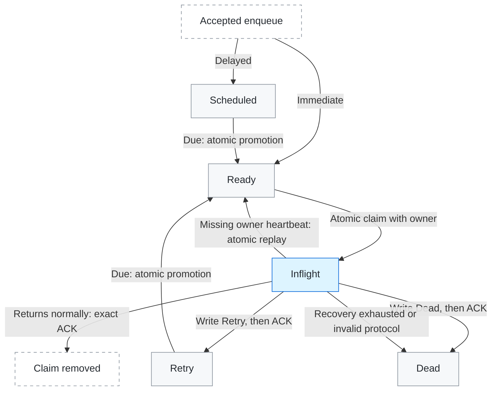

# goat_sidekiq_runtime

This gem extends Sidekiq OSS 7.3.10 with reliable Redis claiming, exact claim ACK and requeue, atomic Scheduled/Retry promotion, optional enqueue and execution locks, strict or weighted queue consumption, process-heartbeat orphan recovery, and Inflight administration. It uses Sidekiq's client, Processor, Poller, Retry/Dead lifecycle, and the official Dead Retry/Delete operations. It has no Rails or PostgreSQL dependency.

## Optional Active Job adapter

Native consumers only need `require 'goat_sidekiq_runtime'`. Applications that use
Active Job can additionally load the adapter (tested with Active Job 7.2.3.1):

```ruby
require 'goat_sidekiq_runtime/active_job'

# Keep the normal runtime producer/server installation described below.
class RefreshProductJob < ActiveJob::Base
  self.queue_adapter = :sidekiq_runtime
  self.enqueue_after_transaction_commit = :default
  queue_as :products
  retry_on Timeout::Error, wait: 10, attempts: 2
  discard_on ActiveJob::DeserializationError

  def perform(product_id)
    Products.refresh(product_id, reconcile: execution_context.redelivered?)
  end
end

RefreshProductJob.perform_later(42)
RefreshProductJob.set(wait: 60).perform_later(42)
```

The wrapper delegates to `ActiveJob::Base.execute`, uses `retry: 0, dead: true`,
and leaves serialization, callbacks, `retry_on`, `discard_on`, and exhaustion
handlers to Active Job. `attempts: 2` includes the first execution. AJ retries
usually live in Scheduled, not Sidekiq's native Retry set. An unhandled final
exception goes to Dead; explicitly handled/discarded errors follow AJ's policy.
The AJ `job_id` survives retry; `provider_job_id` identifies the actual delivery.

`execution_context` is immutable. Its `redelivered?` flag is false on first
submission, true on an explicit AJ `retry_job`, and false for a newly created
child job. It is serialized separately from business arguments. It does not
identify arbitrary duplicate submissions. Native Retry promotion, supported
per-entry Retry/Dead management retries, and runtime shutdown requeue also mark
known redelivery. Automatic orphan recovery also marks redelivery. A runtime-lock
conflict preserves the existing value.

AJ owns transaction deferral when Rails installs its after-commit integration
and the job selects `:default` (or `:always`). The adapter reports after-commit
support and uses a direct `Sidekiq::Client` with the current configuration/pool;
it bypasses `TransactionAwareClient` only for AJ. Native transactional push is
unchanged. Outside deferred transactions, a client middleware rejection makes
`perform_later` return `false` with `enqueue_error`. Transport exceptions propagate;
an unknown Redis reply can mean the message already exists. In a transaction,
the returned Job is provisional: inspect post-commit errors, and remember that
a process exit after database commit but before Redis write remains a gap.
The adapter's ordinary `perform_all_later` path retains AJ's per-job fallback
semantics without enqueue callbacks or this after-commit guarantee; it is not an
atomic batch. If any job handed to this adapter declares runtime uniqueness,
the whole adapter batch raises `SidekiqUniqueness::UnsupportedBulk` before its
first write. AJ groups jobs by adapter; this is not a cross-adapter transaction.

Within an execution, each explicit self-retry must receive confirmation from the
adapter's actual write. Callback cancellation, swallowed `EnqueueError`, pending
or rolled-back deferral, and a caught transport exception do not confirm it.
An unconfirmed retry raises `SidekiqRuntime::ActiveJob::RetryPersistenceError`
before the wrapper can return successfully: Sidekiq retains a Dead failure, or
the exact Inflight claim if failure persistence also fails. A child enqueue or
an unrelated job with the same `job_id` cannot supply this confirmation. A later
commit can still enqueue a successor after the original failure was retained;
applications must tolerate duplicates. Retries must keep their physical queue.
For ordinary AJ jobs, client middleware may route the logical `queue_name` to a
different physical queue. Self-retries are checked after client middleware against
the queue consumed by the original attempt, so routing back to that same physical
queue is allowed. This does not change the serialized AJ `queue_name` or unique
jobs' snapshot queue restrictions.

`sidekiq.notification.active_job_finished` reports `job_class`, AJ `job_id`,
provider `jid`, `physical_queue`, and `outcome`: `succeeded`, `retry_scheduled`,
`discarded`, `retry_exhausted` (handled exhaustion), `handled`, `aborted`,
`retry_unconfirmed`, or `failed`. This event describes AJ execution, not a Redis
ACK. Existing push-result events describe transport writes, including unknown
results. Event-handler failures do not control retry confirmation or ACK.

## Capability comparison

This table compares the built-in capabilities of Sidekiq OSS, its commercial editions, and OSS with this gem. Third-party plugins are excluded. The OSS/runtime baseline is Sidekiq 7.3.10; commercial features reflect the linked official documentation reviewed on September 26, 2026, and may require configuration. They were not tested as part of this gem's acceptance.

| Capability | Sidekiq OSS | Sidekiq Pro | Sidekiq Enterprise | OSS + this gem |
|---|---|---|---|---|
| [Strict / weighted queues](https://github.com/sidekiq/sidekiq/wiki/Reliability#fetch-algorithms) | Supported | Supported | Supported | Supported by the reliable fetcher; strict by default |
| [Crash retention and recovery](https://github.com/sidekiq/sidekiq/wiki/Reliability#recovering-jobs) | No durable claim after fetch | `super_fetch` retains jobs and recovers orphans automatically | Includes Pro | Exact claims with native process heartbeats, bounded recovery, and orphan admin fallback |
| [Atomic Scheduled / Retry promotion](https://github.com/sidekiq/sidekiq/wiki/Reliability#scheduler) | Non-atomic | `reliable_scheduler` | Includes Pro | Exact member moved atomically to Ready |
| [Job uniqueness](https://github.com/sidekiq/sidekiq/wiki/Ent-Unique-Jobs) | Not built in | Not built in | TTL-based uniqueness with configurable unlock policy | Optional enqueue and execution locks; `until_and_while_executing` |
| [Client buffering during Redis outages](https://sidekiq.org/products/pro/) | Not built in | Local buffering and retry | Includes Pro | Not provided; atomic unique enqueue is not outage buffering |
| [Rate limiting](https://github.com/sidekiq/sidekiq/wiki/Ent-Rate-Limiting) | Not built in | Not built in | Shared limiter APIs | Shared physical-queue claim-rate token bucket |
| [Batches and callbacks](https://sidekiq.org/products/pro/) | Not built in | Supported | Includes Pro | Not provided |

Similar feature names do not imply identical guarantees or compatible APIs. In particular, Enterprise uniqueness defaults to unlocking on success and can retain its lock during Retry; this gem releases the enqueue reservation at execution start and uses a separate execution lock. See [uniqueness and retry lifecycle](#uniqueness-and-retry-lifecycle) for the exact contract. Both designs use expiring locks; neither replaces business idempotency.

This gem implements a selected capability set. The application team owns its Redis/Lua code, Sidekiq private-interface integration, recovery operations, and upgrade testing. Commercial editions provide a broader feature set and vendor support; the comparison is not a claim of full Pro/Enterprise parity or a performance benchmark.

## Job lifecycle

The main delivery paths are shown below. Retry and Dead behavior follows the Job's Sidekiq policy; the runtime does not require every failure to retry or reach Dead.



Grey boxes are Sidekiq's existing queues/sets; blue is the runtime's claim state. **Claim removed is an outcome, not a stored Completed state.** Inflight covers the time from claim to ACK, including execution and outcome handling; it does not mean the Job is currently inside `perform`.

- **Claim and promotion are atomic Redis moves.** Ready becomes an exact Inflight claim with an owner; due Scheduled/Retry members move to Ready.
- **Successor writes and ACK are separate operations.** Retry, Dead, or a continuation can already exist while the original claim remains unacknowledged. The diagram shows the normal progression, not mutually exclusive states at every instant. Re-execution is possible.
- **ACK is a delivery acknowledgement.** Redis accepting an enqueue, removing a claim, and completing business effects are different events. Retry-disabled or discarded outcomes still follow Sidekiq policy; there is no promise of eventual business success.

Other paths use the same states:

| Trigger | Transition |
|---|---|
| Optional execution-lock conflict | Persist a same-JID Scheduled continuation, then ACK the current claim. Business execution has not started. This is distinct from ordinary Retry. |
| Shutdown interrupts unfinished work | Atomically requeue the exact claim from Inflight to Ready, preserving original business arguments and identity and marking redelivery. A Job that finishes during the grace period follows its normal outcome instead. |
| Abrupt process death or an unconfirmed outcome | Once its owner heartbeat disappears, automatic recovery atomically moves the claim to Ready, or to Dead on recovery exhaustion/protocol error. See [Inflight and recovery](#inflight-and-recovery). |
| Native Dead Retry / Delete | Retry removes the Dead entry and pushes to Ready using Sidekiq's non-atomic management path; Delete removes the Dead entry. See the [management support matrix](#management-api-support). |

## Install and configure

Publish the gem to GOAT's GitHub Packages registry before installing it in the application. Authenticate Bundler with a GitHub user and a token that can read packages:

```shell
bundle config https://rubygems.pkg.github.com/goatapp USERNAME:TOKEN
```

Add the package source to the application's `Gemfile`:

```ruby
source 'https://rubygems.pkg.github.com/goatapp' do
  gem 'goat_sidekiq_runtime', '0.3.0', require: false
end
```

Install the same exact resolved version in every producer, worker, Poller, and management process sharing one Sidekiq Redis logical DB. They must also use the same `SidekiqRuntime::Storage` namespace. Requiring the gem only loads definitions:

```ruby
require 'goat_sidekiq_runtime'

redis_config = {url: ENV.fetch('SIDEKIQ_REDIS_URL')}
storage = SidekiqRuntime::Storage.new(namespace: 'myapp:srt:v1')

Sidekiq.configure_client do |config|
  config.redis = redis_config
  SidekiqRuntime.install_producer!(storage: storage)
end

Sidekiq.configure_server do |config|
  SidekiqRuntime.install_server!(config, redis_config: redis_config, storage: storage)
end
```

The generic namespace defaults to `srt:v1`; the application must choose one shared namespace. The first explicit installation pins that namespace for the process. Repeating installation with another `Storage` object for the same namespace is allowed; a different namespace raises before runtime configuration changes. Reading the lazy default before installation does not pin it. It names only runtime-owned keys: `<namespace>:queues`, `<namespace>:queue:<queue>:inflight`, `<namespace>:queue:<queue>:inflight:owners`, `<namespace>:queue:<queue>:rate_limit`, and default locks under `<namespace>:unique`. Sidekiq still owns `queue:<queue>`, `schedule`, `retry`, and `dead` in that Redis DB. A namespace does **not** isolate applications sharing a logical DB; all Sidekiq queues in the DB must use this runtime. Workers consume only their configured queues, while a Poller promotes due members from the DB-wide Scheduled and Retry sets. Direct low-level Redis writes that bypass the supported producer interface are outside this contract.

The server takes its queue list, concurrency, and timeout from Sidekiq configuration. Strict order is the default; weighted entries are optional. Startup verifies the effective default Capsule fetcher, its full queue/weight binding, and the required server middleware and final client persistence boundary. It fails instead of replacing already-cached Sidekiq objects. Additional middleware is allowed. `retry_queue` is unsupported. Ordinary jobs use Sidekiq's native client persistence. Jobs that opt into uniqueness use one atomic Redis write for the job and its enqueue lock. Unique Active Job `perform_all_later` raises `SidekiqUniqueness::UnsupportedBulk` before middleware or the first write; it is not simulated as serial pushes. Ordinary native bulk keeps Sidekiq's upstream batch persistence path.

| API or object | Scope and responsibility |
|---|---|
| `install_producer!(storage:, event_handler:)` | Process-wide namespace, event handler and client/management hooks. It does not bind a Redis connection. |
| `install_server!(config, redis_config:, ...)` | Also installs producer hooks, then binds the Config's Redis, fetcher, middleware, Poller and reclaimer lifecycle. Queues and recovery settings are finalized at startup. |
| `QueueRateLimit.new(config)` | Reads and updates policies in that Config's Redis. `enable`/`disable` return the stored `before` and resulting `after` policies. |
| `InflightCollection.new(config:, queues:)` | Uses that Config's Redis and the queue set selected at construction. Pass its own entries to `state`/`recover_orphan`; display state never authorizes recovery. |
| `SidekiqRuntime::ServerMiddleware` | Prepares metadata and the actual physical queue for every AJ, then applies optional uniqueness. Keep application execution middleware after it. |
| `SidekiqRuntime::ActiveJob::Execution` / `RetryRequest` (internal) | One Execution per wrapper invocation; retry requests are shared through AJ copies only in memory. Confirmed successor writes determine the final AJ outcome; Redis ACK is a separate operation. |

## Queue rate limits

Physical queues are unlimited by default. `QueueRateLimit` can enable one Redis-backed token bucket shared by every runtime worker consuming the same physical queue, namespace, and Redis logical database:

```ruby
limits = SidekiqRuntime::QueueRateLimit.new(Sidekiq.default_configuration)
limits.enable('imports', rate: 2.5, burst: 5)
limits.get('imports')
limits.disable('imports')
```

`rate` is the allowed claim rate per second and may be fractional. `burst` is the positive integer token capacity. Enabling a new policy starts with a full bucket. Workers apply the current policy on their next claim attempt; a denied claim leaves the job in Ready and does not consume a token. Jobs that are already Inflight or running are unaffected. After a retry or requeue returns a job to Ready, its next successful claim consumes another token.

Updating a policy first refills its existing tokens at the old rate, then clamps them to the new burst. Saving a policy therefore does not reset it to a full bucket or grant a fresh burst. Disabling deletes the bucket and makes later claims unlimited; enabling it again intentionally creates a new full bucket.

This limits claims from one physical queue. It is not a concurrency limit, enqueue-rate limit, database-QPS limit, or guarantee about job completion throughput. Producers, Scheduled/Retry promotion, ACK, and requeue semantics are unchanged. Every consumer of a limited queue must run this runtime version; a consumer that bypasses the reliable fetcher also bypasses the shared bucket.

## Uniqueness and retry lifecycle

Active Job declares the single `until_and_while_executing` policy with:

```ruby
class RefreshProductJob < ActiveJob::Base
  self.queue_adapter = :sidekiq_runtime
  queue_as :products
  runtime_uniqueness enqueue_ttl: 24.hours, runtime_ttl: 60.seconds,
                     key: ->(job) { job.arguments.first }
end
```

The key may return one stable business value; it does not have to return an Array.
For a GlobalID argument, prefer an immutable key such as `job.arguments.first.id`.
AJ serializes the key as a one-element identity Array. Choose stable identity
fields, not request time, trace fields, redelivery flags or mutable model data.
A class that declares this enhancement and chooses an unsupported adapter such
as `:resque` raises before enqueue, including AJ bulk grouping. Plain jobs may
still choose another adapter.

Only Active Job exposes custom uniqueness. Native Sidekiq Jobs use ordinary
enqueue, execution, Retry and Dead behavior. Use `runtime_uniqueness` on Active
Job for the scope **business Job class + physical queue + one identity**.
Enqueue and execution have separate keys and TTLs for that same identity.

The snapshot lives in `sidekiq_runtime.uniqueness` alongside `redelivered` on the
Sidekiq transport payload. It contains `job_class`, `queue`, serialized `identity`,
the scoped `key_prefix`, and both TTLs. AJ also carries this metadata at
`args[0].sidekiq_runtime` so `Base.execute` and later self-retries preserve it.
The outer transport copy is authoritative: `JobMetadata.with_redelivery` updates
both copies, and server middleware synchronizes the AJ copy before execution.
No business argument is added or rewritten. Do not edit this internal metadata.

Uniqueness does not impose a retry or Dead retention policy. Native `retry: false`,
`retry: 0`, and `dead: false` retain Sidekiq's meanings; no reliability policy is
silently upgraded. The AJ wrapper keeps its one default `retry: 0, dead: true`.

The policy is `until_and_while_executing`, not uniqueness until terminal success:

| Phase | Reservation behavior |
|---|---|
| Initial Ready or Scheduled enqueue | One atomic write stores the payload and an enqueue lock owned by its JID. While that lock is valid, a new submission for the same identity is filtered, even if it supplies the same JID. |
| Execution start | The worker first acquires a per-attempt runtime owner token, then deletes the enqueue lock only if the current JID still owns it. After Job A releases its reservation, Job B may be accepted. While B owns the new reservation, Job C is filtered, and A's later Success or Dead cleanup does not remove B's lock. |
| Success or ordinary failure | The runtime token is released. A native Retry or an AJ self-retry waits without creating or extending an enqueue reservation, so a new same-identity Job may be accepted. AJ retries preserve the snapshot and use only the current in-memory retry request to select this path; `redelivered` and matching `job_id` are not retry admission signals. |
| Sidekiq shutdown | Before releasing its runtime token, the current JID attempts to restore its own enqueue reservation for the Inflight/Ready handoff. Restoration can fail when another JID owns the reservation or Redis is unavailable. |
| Runtime-lock conflict | Stores a same-JID Scheduled continuation delayed by `runtime_ttl + 1` seconds without entering business `perform`, increasing AJ `executions`, or changing redelivery. Its enqueue reservation is created when absent, refreshed when owned by that JID, and left unchanged when owned by another JID. This is not an ordinary Sidekiq Retry. When the runtime TTL expires, concurrent execution can occur. |

The enqueue lock for a Scheduled unique job lasts for `configured_enqueue_ttl + ceil(max(scheduled_at - enqueue_time, 0))` seconds. The configured TTL is therefore the duplicate-filtering window *after* the scheduled time, if the job is promoted on time. A longer actual queue wait can outlive that window. Runtime locks also have TTLs and do not guarantee one instance for an arbitrarily long job. Business idempotency remains the Job's responsibility.

Active Job unique enqueues do not support `Sidekiq::Testing.fake!` or
`Sidekiq::Testing.inline!`. They raise `ArgumentError` before client middleware or
Redis persistence. Use `Sidekiq::Testing.disable!` with a dedicated Redis instance
for uniqueness tests. Ordinary jobs retain Sidekiq's fake/inline behavior.

## Inflight and recovery

A payload in Inflight is a Redis claim with an exact owner that has not yet been ACKed. It does not show that execution started or that business work completed. ACK removes that exact claim after execution returns successfully or after Sidekiq accepts the applicable successor write, such as Retry, Dead, or a runtime-conflict continuation. Redis accepting an initial enqueue, business completion in another system, successor persistence, and ACK are separate events; the gem does not claim persistence through a Redis failure.

Every claim atomically stores its exact member, process owner and Redis claim time.
A worker cannot claim until Sidekiq has written its first native heartbeat. The
owner hash must have a positive TTL. This gem does not create a job renewal
thread, registry, or second heartbeat. Sidekiq 7.3.10 refreshes its process key
approximately every 10 seconds with a 60-second TTL, including while quiet or
waiting for graceful shutdown. Trusted Manager shutdown still requeues held work.

Recovery is authorized only when the exact owner's native heartbeat key is
absent. The Lua move rechecks the exact claim, owner and missing heartbeat in one
operation; a stale display or two competing reclaimers cannot move it twice.
Wrong key types, nonexpiring heartbeats, missing owners and Redis failures are
unknown, never permission to take over. A lost write reply stays unknown; do not
blindly enqueue a second copy.

`recover_orphan` and the recovery event report `reason` and `recovery_count` only
when the atomic result is `requeued` or `dead`. Results such as `owner_alive`,
`owner_changed` and `missing` report no applied recovery reason or count; preparing
a replay does not mean Redis authorized or performed it.

The reclaimer advances bounded cursors through the persistent queue directory
and each queue's claims, including unconfigured queues and old claims behind
healthy owners. It retains oversized Redis SCAN pages and processes only the
configured budget each tick. Recovery latency depends on heartbeat expiry,
backlog, scan progress and Redis availability; there is no 60-second recovery SLA.

If an ACK or fetch-return exception leaves a claim behind while the process is
still heartbeating, the claim remains retained. The Processor boundary emits
`unconfirmed_release` with the claim ID, JID, queue and owner for manual review.
It never kills or replays a live owner automatically. Inspect the worker, quiet
it and let held work drain; restart that owner if the claim is stranded. After
its heartbeat disappears, normal recovery (or the same Admin action) applies.
A CLAIM may have committed even when its Redis reply is lost. In that case the
client does not know the exact claim ID and cannot emit an exact
`unconfirmed_release` diagnostic. Use the unknown-claim event and the Inflight
view to locate the owner; manual restart follows the same procedure.
Do not delete a live heartbeat or force-requeue an unverified claim.

Recovery preserves original business arguments, AJ `job_id`, the producer's
uniqueness snapshot and opaque context. Only transport metadata changes, and the
serialized AJ metadata copy is synchronized. No recovery path loads a business
class or evaluates identity.
`sidekiq_runtime.recovery_count` counts abnormal orphan recoveries, separately from
AJ executions/native retry counts. After **3** replays, a further orphan goes to
Sidekiq Dead with `error_class: SidekiqRuntime::RecoveryError` and
`error_message: recovery_exhausted`. Invalid transport envelopes or unsupported
`retry_queue` go directly to Dead with `invalid_protocol`. Unparseable JSON is
retained raw, following Sidekiq's invalid-JSON Dead convention. Dead retention
uses the configured Sidekiq timeout and maximum size. Recovery does not invoke
business death handlers or repair uniqueness locks; normal owner release and lock
TTLs still apply. This terminal transport policy applies even to a job with business `retry: false` / `dead: false`; it does
not override successful AJ `discard_on` or explicitly handled outcomes. Dead
manual retry retains the crash budget; an operator must fix the cause rather
than turn retry into an automatic budget reset.

Normal shutdown and execution-lock conflict do not spend this recovery budget
or add business retries. The process heartbeat is independent of the execution lock TTL.
Neither is fencing: a paused or partitioned old executor can overlap a replay.
Business effects must remain idempotent. Recovery requires an active runtime
worker; if every worker is stopped/quiet, recovery resumes on the next startup.

One immutable engine policy configures recovery:

```ruby
recovery = SidekiqRuntime::RecoveryConfiguration.new(
  reclaim_interval: 5, reclaim_batch: 100, queue_batch: 10, max_recoveries: 3
)
SidekiqRuntime.install_server!(config, redis_config: redis_config, storage: storage, recovery: recovery)
```

These are defaults. Each tick visits at most 10 queues and examines at most 100
claims per queue. Batch sizes are 1–1000; interval must be finite and positive.
Admin without server installation uses the same `config[:runtime_recovery]`.
Finalize Sidekiq CLI/YAML queues before installation/startup. Startup compares
that input with the real default Capsule and fetcher. Live queue/configuration
mutation is unsupported; change it by restarting workers.

### Administration and observations

The host owns authentication, authorization and audit. Find a fresh exact claim:

```ruby
collection = SidekiqRuntime::InflightCollection.new(config: config)
entry = collection.find_entry(entry_id, physical_queue: queue)
state = collection.state(entry) if entry
result = collection.recover_orphan(entry) if entry # atomic owner recheck
queue_snapshots = collection.snapshots
```

`collection.entries(offset: 0, limit: 100)` browses the first **1,000 entries**
of the selected collection, globally ordered by claim time across its queues.
`offset + limit` must not exceed 1,000; this is a browsing window, not a per-page
limit that permits unlimited pagination. Exact lookup by queue and `entry_id`
is independent of that window.

State includes `status` (`owner_alive`, `owner_dead`, `missing`, `owner_missing`,
`owner_changed`, `unknown`), `recoverable`, heartbeat TTL, Redis time and recovery
count. Alive means process liveness, not proof that the job is executing.
Recovery outcomes add `requeued` and `dead`. There is no force option.
`InflightStore#requeue` is only the trusted executor/Manager shutdown primitive;
it must not be exposed through Admin.

Queue snapshots contain `known`, `protocol_version`, `redis_now`,
`inflight_count`, and `oldest_inflight_age_seconds`. A failed snapshot is
`{known: false}`, never zero. Metrics reuse these bounded snapshots; individual
owner state belongs in the paginated Admin view.

Events pass through one isolated `SidekiqRuntime.event_handler` boundary,
including field construction. Observability failures cannot suppress business
or Redis errors. `orphan_reclaimer.sidekiq_runtime` reports recovery outcomes;
`reliable_fetch.sidekiq_runtime` reports claim, ACK, and `unconfirmed_release`.
Claim/JID/owner IDs belong in logs, not metric labels. Events are best-effort
observations, not a business success ledger.

## Management API support

| Operation | Contract |
|---|---|
| Inflight `recover_orphan` | Exact atomic owner-heartbeat recheck; alive/unknown state never permits takeover. Same recovery budget/Dead policy as automatic recovery. |
| Runtime Poller promotion from Scheduled or Retry | Supported. The exact source member moves atomically to Ready without producer middleware or identity evaluation. Retry promotion adds redelivery metadata; Scheduled promotion preserves it. |
| `SortedEntry#add_to_queue` or `#retry` for a unique AJ Scheduled entry | Rejected before Sidekiq removes the source, even for a unique AJ retry in Scheduled. Let the runtime Poller promote it when due. Ordinary Scheduled entries retain native behavior. |
| `ScheduledSet#retry_all` / inherited bulk Ruby management APIs | Outside the runtime management contract. They bypass the per-entry guard and metadata boundary; applications must not expose them. No all-or-nothing management batch is promised. |
| Per-entry native Retry or Dead `#retry` / `#add_to_queue` | Supported for native/AJ envelopes. Mark redelivery and preserve the original identity; bypass fresh reservation admission through this explicit boundary, including entries without `retry_count`. `#retry` decrements an existing counter as upstream does; no counter is fabricated. |
| Official Dead Delete | Supported native deletion. It does not release runtime locks or delete a newer job's reservation. |
| Queue or SortedEntry delete; Queue/SortedSet clear | Native data operations only. Enqueue/runtime locks are not repaired or removed; an orphaned reservation can remain until TTL expiry. |
| SortedEntry reschedule | Native score change only. The original reservation TTL is not extended/recomputed; postponing beyond it can admit duplicates before due time. |

Per-entry Retry/Dead management retains Sidekiq's **non-atomic remove-then-push**
semantics. Middleware rejection or Redis failure after removal can lose the
source; metadata wiring does not turn this into an atomic runtime move. Manual
retry does not create/extend a reservation and cannot clear a newer JID's lock.
Direct Redis writes or user-supplied retry/continuation markers are not supported
ways to bypass admission.

Reliable Redis ACK does not prove that business work completed. A job can run more than once, and Redis cannot atomically commit a business side effect in another system. This gem does not guarantee exactly-once execution, infinite retry, automatic business compensation, indefinite deduplication, or zero loss during Redis failure; durability depends on Redis persistence and recovery. It does not provide cross-DB scheduling or all commercial Sidekiq features.

The gem depends on private Sidekiq 7.3.10 behavior, so a Sidekiq upgrade requires the included producer, Processor, Poller, and process contract suites to pass. The Poller processes at most 100 due items per source set per tick; this is a scan budget, not business rate limiting. The event handler receives `job_payload` as read-only context where available; application adapters must not mutate that context. Unique bulk is rejected before writing and emits no bulk-write summary; ordinary bulk stays on Sidekiq's native path. A successful fetch records `empty_claims`, `claim_duration_ms`, and `pickup_latency_ms` with its claimed event. A timeout emits one `reliable_fetch.sidekiq_runtime` poll event with `outcome: idle`, aggregate empty claims, claim duration, and poll duration, without logging every empty Redis probe.

## Local tests

Use Ruby 3.4.7 and the locked bundle. Run `bundle exec rubocop --config .rubocop.yml --no-server` for the gem-local lint checks. Set `GOAT_RUNTIME_TEST_REDIS_URL` to a dedicated loopback Redis URL outside port 6379 (default: `redis://127.0.0.1:17779/15`) and run `bin/test specs`. Run the process suite separately with `SIDEKIQ_RUNTIME_EVIDENCE_DIR=/tmp/... bin/test process`. Its Redis restart scenario also needs `GOAT_RUNTIME_TEST_REDIS_RESTART_COMMAND`, an absolute executable that restarts only that dedicated instance. The suites do not flush a database.

The existing `test-goat-sidekiq-runtime-gem` CI job runs `bin/test specs`, which
includes the Active Job contracts, followed by the serial process subset:

```sh
SIDEKIQ_RUNTIME_EVIDENCE_DIR="$PWD/artifacts/process" bin/test process --tag ci_smoke
```

This subset covers quiet/graceful shutdown heartbeat, AJ KILL recovery with two
reclaimers, and ACK/fetch-return faults followed by manual owner restart. It uses
the real native heartbeat lifetime; only the scan interval is shortened. The
separate `spec/process/safety_acceptance_spec.rb` verifies STOP/CONT overlap and
stale ACK/lock-release protection. Neither test is a production recovery SLA.
CI retains journals, signals, snapshots, assertions and package build metadata.
Building 0.3.0 does not publish it.
